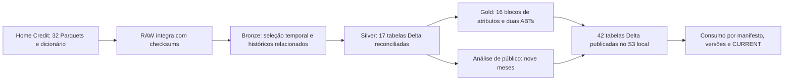

# Credit Risk Lakehouse

Projeto de engenharia de dados de crédito com **Python, PySpark, Delta Lake e
S3 local (SeaweedFS)**. Integra todas as **17 tabelas lógicas de treino** da
competição Home Credit — Credit Risk Model Stability e entrega bases analíticas
por caso (ABTs), indicadores e análise de público para **447.305 casos** de
janeiro a setembro de 2020.

A entrega inclui aquisição rastreável, camadas RAW/Bronze/Silver/Gold,
reconciliação com as fontes, contratos de qualidade, publicação versionada e
recuperação de falhas. Foi executada com dados reais em ambiente local Linux/WSL.



## Entrega atual

| Componente | Resultado executado |
|---|---|
| Fontes | 17 tabelas lógicas em 32 Parquets, mais dicionário |
| População | 447.305 casos de janeiro–setembro/2020, sem amostragem na janela |
| Bronze / Silver | 92.174.107 linhas entre as 17 tabelas; 17 Silver Delta |
| ABT de desenvolvimento | 259.695 casos de janeiro–maio/2020 |
| ABT de avaliação temporal | 187.610 casos de junho–setembro/2020 |
| Atributos | 166 retrospectivos em 16 blocos, com features e labels separadas |
| Análise de público | Cinco tabelas analíticas, relatório e gráficos de nove meses |
| Publicação | 42 tabelas Delta no S3 local, com manifestos e ponteiro CURRENT |
| Validação registrada | 174 testes aprovados, zero ignorados; matrizes T01–T24 e X01–X17 |

A fonte completa contém 1.526.659 casos. O projeto seleciona os casos pela
`date_decision`, no intervalo `[2020-01-01, 2020-10-01)`, e preserva os históricos
auxiliares relacionados. As 92 milhões de linhas incluem esses históricos;
não representam pessoas ou casos únicos. Uma das 17 tabelas não tem linhas na
janela e mantém seu schema na entrega.

As duas ABTs têm uma linha por caso, o mesmo contrato e interseção vazia de
`case_id`. Cada conjunto de features tem 170 colunas: 166 atributos e quatro
metadados. Os rótulos ficam em tabelas próprias com `case_id/target`; a ABT lógica
reunindo features e rótulo tem 171 colunas.

Veja os [resultados da análise de público](docs/analise/PUBLICO_EXPANSAO.md), a
[arquitetura](docs/entrega/ARQUITETURA.md) e os
[contratos Silver e ABTs](docs/contratos/EXPANSAO_SILVER_E_ABT.md).

## Garantias verificadas

- **Origem e preservação:** catálogo versionado, arquivos RAW completos com SHA-256 e reuso de aquisições íntegras.
- **Qualidade e reconciliação:** comparação da Bronze com a RAW selecionada, contratos por tabela, chaves e vínculos históricos auditados e conversões Silver sem perda observada.
- **Construção das ABTs:** agregações antes dos joins, comparação com SQL independente, preservação da população e uma linha por caso.
- **Publicação consistente:** manifestos com versões Delta, UUIDs e checksums; ativação de CURRENT após aprovação do conjunto exigido.
- **Recuperação:** falhas antes e depois da ativação, retry, rollback, leitura histórica, reinício do serviço e consumo em outra JVM verificados.

As correções auxiliares e os cenários de chegada/reenvio são **simulações
declaradas** sobre dados reais. A competição não fornece CDC. A publicação atual
da expansão aponta para os dados originais; a correção artificial permanece
em histórico separado.

## Finalidade das ABTs e limites

As ABTs foram construídas e validadas para **análise retrospectiva**, conforme os
contratos e as evidências da entrega. Sua adequação temporal para treinar e avaliar
um modelo preditivo ainda depende de comprovar a disponibilidade dos atributos
na data da decisão e a janela de maturação do `target`. A separação por caso
não comprova independência por pessoa entre os períodos.

Por isso, o leitor de ML mantém `ml_ready=false`. Essa pendência delimita o uso
preditivo; a validação de integridade, agregação e publicação das tabelas está
registrada. Nenhum modelo foi treinado. Os indicadores descrevem a população
histórica selecionada e não representam uma taxa operacional atual de crédito.
[Auditoria temporal](docs/evidencias/E04_ATRIBUTOS_E_TEMPO.md).

A solução foi verificada em um host/driver com escritores cooperantes. Delta
oferece transações por tabela; o manifesto e CURRENT coordenam a publicação do
conjunto na aplicação. Não há validação em cluster, concorrência distribuída,
SLA, streaming, agendador ou recursos AWS provisionados.

## Ambiente e acesso aos dados

Requisitos: Linux x86_64 ou WSL2, Bash, Python 3, acesso à rede para instalação
e aquisição e conta Kaggle com acesso próprio à competição. Dados reais,
derivados e credenciais permanecem locais, fora do Git.
[Fonte e condições de uso](docs/governance/SOURCE.md).

```bash
bash scripts/bootstrap_environment.sh
bash scripts/bootstrap_analysis.sh
bash scripts/bootstrap_objects.sh
```

Os bootstraps instalam Python 3.11.14, Java 17.0.21+9, Spark 3.5.7, Delta 3.3.2 e
SeaweedFS 4.53 em `.venv/` e `.runtime/`, com versões e hashes declarados. Não é
necessário instalar Spark separadamente ou usar Docker. Configure a autenticação
Kaggle conforme as [instruções de aquisição](docs/evidencias/F00_F02_FONTE_REAL.md).

O [perfil da expansão](configs/spark_expansion.yaml) usa `local[2]` e heap do
driver de **8 GiB**. O host de execução tinha cerca de **15,46 GiB visíveis** no
Linux/WSL. O pico RSS amostrado da árvore de processos na Silver foi de
**9,59 GiB**; RSS inclui memória fora do heap e pode contar páginas compartilhadas.
Essas medidas são referências observadas, não requisitos mínimos garantidos.
Preveja disco para RAW, camadas materializadas, shuffle e versões publicadas.
[Ambiente](docs/AMBIENTE_LOCAL.md) e [capacidade medida](docs/evidencias/E07_PUBLICACAO_EXPANSAO.md).

## Reproduzir a entrega atual

Execute na raiz do repositório, no mesmo terminal Bash. Cada comando deve
terminar com código zero antes do próximo. Os IDs são produzidos pela execução;
não copie os IDs históricos das evidências.

### 1. Adquirir as fontes e construir a Bronze

```bash
mkdir -p artifacts/reproduction-expansion
REPRO_DIR=artifacts/reproduction-expansion

json_field() {
  bash scripts/project.sh -c '
import json, sys
value = json.load(open(sys.argv[1]))
for key in sys.argv[2].split("."):
    value = value[key]
print(value)
' "$1" "$2"
}

bash scripts/project.sh -m scripts.acquire_expansion
bash scripts/project.sh -m scripts.build_expansion_bronze > "$REPRO_DIR/bronze.json"
BRONZE_ID=$(json_field "$REPRO_DIR/bronze.json" selection_id)
```

A aquisição verifica os 33 arquivos do catálogo e reutiliza arquivos íntegros.
A Bronze seleciona os casos pela política temporal e conserva todas as linhas
auxiliares relacionadas, inclusive históricos fora da janela de decisões.
[Evidência Bronze](docs/evidencias/E02_BRONZE_TEMPORAL.md).

### 2. Construir Silver, auditar atributos e gerar as ABTs

```bash
bash scripts/project.sh -m scripts.run_expansion silver \
  --bronze-id "$BRONZE_ID" > "$REPRO_DIR/silver.json"
SILVER_ID=$(json_field "$REPRO_DIR/silver.json" id)

bash scripts/project.sh -m scripts.run_expansion audit \
  --silver-id "$SILVER_ID" > "$REPRO_DIR/audit.json"

bash scripts/project.sh -m scripts.run_expansion gold \
  --silver-id "$SILVER_ID" > "$REPRO_DIR/gold.json"
GOLD_ID=$(json_field "$REPRO_DIR/gold.json" id)
```

A auditoria registra as pendências temporais; sua aprovação como procedimento
não aprova os atributos para ML. A Gold entrega features e labels separadas
para os dois períodos, com reconciliação independente.
[Evidência Silver](docs/evidencias/E03_SILVER_EXPANSAO.md) e
[evidência das ABTs](docs/evidencias/E05_ABTS_TEMPORAIS.md).

### 3. Gerar a análise de público

```bash
bash scripts/analysis.sh -m scripts.run_expansion analysis \
  --silver-id "$SILVER_ID" --gold-id "$GOLD_ID" > "$REPRO_DIR/analysis.json"
ANALYSIS_ID=$(json_field "$REPRO_DIR/analysis.json" id)
```

O pacote fica em `data/gold/expansion-analysis/<ANALYSIS_ID>/`, com manifesto,
tabelas e relatório. A análise cobre janeiro–setembro, incluindo as duas
populações. [Evidência da análise](docs/evidencias/E06_PUBLICO_EXPANSAO.md).

### 4. Publicar no S3 local e verificar a recuperação

A trilha de entrega exercita também uma correção auxiliar simulada, gera seus
produtos e verifica falhas, retomada e rollback. Ao final, CURRENT aponta para a
publicação dos dados originais e o histórico simulado fica preservado.

```bash
bash scripts/project.sh -m scripts.run_expansion revision-demo \
  --silver-id "$SILVER_ID" > "$REPRO_DIR/revision.json"
CORRECTED_SILVER_ID=$(json_field "$REPRO_DIR/revision.json" id)

bash scripts/run_expansion_delivery.sh \
  "$SILVER_ID" "$GOLD_ID" "$ANALYSIS_ID" "$CORRECTED_SILVER_ID"

bash scripts/objects.sh -m scripts.deliver_expansion consume \
  --selection-id "$BRONZE_ID"
```

Confira `status: passed` nos recibos e relatórios em `artifacts/expansion/`.
A entrega verifica as fontes e reutiliza snapshots locais aprovados; essa etapa
não recompõe RAW→Gold do zero. O consumidor lê via S3/S3A em processo separado.
O namespace é `lakehouse-expansion-v1`, independente do MVP. O serviço permanece
ativo para consumo; para encerrá-lo:

```bash
bash scripts/objects.sh -m src.object_store.service stop
```

[Publicação, recuperação e consumo](docs/evidencias/E07_PUBLICACAO_EXPANSAO.md).

## Testes e reprodução sem Kaggle

Após os bootstraps, os checks e a regressão com integrações reais são:

```bash
bash scripts/project.sh scripts/check_code.py
bash scripts/project.sh scripts/run_tests.py --integration-required
bash scripts/project.sh scripts/check_acceptance.py --report artifacts/tests/report.json
bash scripts/project.sh scripts/check_expansion_acceptance.py --report artifacts/tests/report.json
```

A [aceitação da expansão](docs/evidencias/E08_ACEITACAO_EXPANSAO.md) registra
**174 testes aprovados, zero ignorados**, com Spark, Delta, S3 e os dois e2e.
As matrizes [T01–T24](docs/testes/MATRIZ_ACEITACAO.md) e
[X01–X17](docs/testes/MATRIZ_EXPANSAO.md) relacionam requisitos e verificações.
A execução registrada é local; não se declara execução remota da CI.

Sem credenciais ou dados Home Credit, execute os fluxos completos com fixtures
sintéticas:

```bash
bash scripts/project.sh scripts/run_tests.py --suite e2e --integration-required
```

Esse comando cobre MVP e expansão. O e2e da expansão usa cinco fontes inventadas
de níveis 0/1/2 e publica 18 Delta em prefixo temporário. Ele verifica o fluxo e
seus bloqueios; os números da entrega real vêm das evidências com as 17 fontes.
[Execução dos testes](docs/testes/EXECUCAO_E_CI.md).

## Histórico e documentação

O projeto começou com três tabelas e um recorte determinístico de 50 mil casos.
Esse MVP permanece preservado para regressão e consulta histórica; a entrega
atual usa todas as tabelas de treino e seleção temporal sem teto de casos.
O [roteiro original](docs/ROTEIRO_EXECUCAO_LAKEHOUSE.md) documenta a primeira
entrega e o [roteiro da expansão](docs/ROTEIRO_EXPANSAO_HOME_CREDIT.md) reúne as
fases E00–E08 e suas evidências.

| Referência | Conteúdo |
|---|---|
| [Índice da documentação](docs/README.md) | Contratos, operação e evidências |
| [Arquitetura](docs/entrega/ARQUITETURA.md) | Componentes e garantias |
| [Contratos da expansão](docs/contratos/EXPANSAO_SILVER_E_ABT.md) | Grãos, tipos, atributos e ABTs |
| [Resultados de público](docs/analise/PUBLICO_EXPANSAO.md) | Análise e limitações dos indicadores |
| [Operação S3](docs/objetos/OPERACAO.md) | Serviço e persistência |
| [Guia de estudo](docs/GUIA_ESTUDO_LAKEHOUSE.md) | Percurso didático pela implementação |
